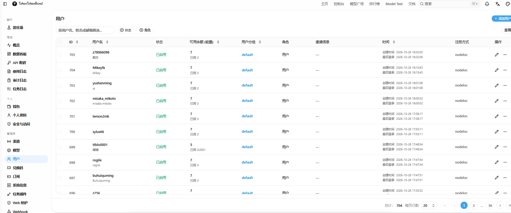

这是我上周五的时候，临走时agent给的最后汇报

1. 全站 auto 路由（自建，不再用 new-api combo）
new-api 的 combo 在上游失败时会 panic（channel 为 nil），所以弃用，改成自建路由服务：
- 服务：ttb-autorouter，监听 127.0.0.1:8091
- 渠道：ttb-auto（id=16，priority=20）
- 候选顺序：gpt-6-mini → big-pickle(zen) → grok-chat-fast → deepseek-v4.1-flash(speedai)
- 每 60 秒后台探活，按实测延迟排序，坏掉的进冷却，永不把请求卡在死上游
- 支持 stream 与非流式；响应头 x-auto-served-by 可看到实际命中
实测：auto 稳定 2–3 秒返回，上游全挂时返回明确错误而不是挂死。
2. 模型列表清理
- 已删除所有 -free 后缀：现在对外是 beam、flint-40b、glm-5.3-flash、mimo-v2.6-flash、nemotron-3.5-lightning、nemotron-3.5-super-vl、deepseek-v4.1-flash、big-pickle（渠道 14 用 model_mapping 映射到上游真实名，用户看不到后缀）
- GPT 只保留面向用户的型号：gpt-5-6、gpt-5-6-mini、gpt-6、gpt-6-mini、gpt-image-2、research
- 剔除了内部型号（gpt-5-6-t-mini、gpt-6-t-mini-mini 等）
- 每个模型补了正常显示名与中文介绍，例如：
模型	显示名
gpt-6	GPT-6
gpt-6-mini	GPT-6 mini
big-pickle	Big Pickle
3. 渠道守护（解决"挂 85 秒"）
新增 ttb-guard.timer，每 5 分钟探测 zen / gpt 上游：
- 不可用 → 自动把渠道置为禁用（请求立刻失败，22ms 而不是 85 秒）
- 恢复 → 自动重新启用
刚才就是它把 zen(14)、gpt(13) 自动下线了，所以现在：
auto 3.0s ✅
deepseek-v4.1-flash 1.5s ✅
grok-chat-fast 2.2s ✅
grok-4.7 6.3s ✅
beam / gpt-6-mini → 22ms 明确报错（渠道被守护摘除）
4. Hermes 自主运维 Agent（你要的那个）
已部署 ttb-hermes（8092）+ 每 10 分钟一轮：
- 采集：渠道状态、auto_ban、15 分钟错误数、错误模型 TOP、systemd/docker 状态、autorouter 探活、searxng
- 决策：规则引擎（可靠、不依赖模型 JSON）→ 动作只允许 restart_service / set_channel_status / set_channel_priority / probe_url
- 点评：LLM（用我们自己的 auto）追加一段中文风险点评
- 审计：/opt/aistack/hermes/audit.jsonl，可 /audit、/status 查询
- 安全：默认 apply_enabled=false（只给建议不改系统），要真正自动执行改成 true 即可
刚才那轮它自己发现了：2 个渠道被 auto_ban、gpt/zen 探测超时、内存压力，并给出了处置动作。
5. DeepSeek 式搜索/抓取 API（已实现）
按 DeepSeek Search/Fetch 规格实现，外加两项它没有的：
端点	说明
POST /v1/tools/search	query/count/ori_question/need_content，返回 rerank_score、title、url、snippet、summary、content、site_name、site_icon、date、authority
POST /v1/tools/fetch	URL → Markdown 正文（trafilatura 提取，带 SSRF 防护）
POST /v1/embeddings	本地 bge-small-zh-v1.5，512 维，OpenAI 兼容
POST /v1/rerank	语义+关键词+权威度+时效 综合打分
POST /v1/tools/answer	搜索→抓正文→LLM 总结→带 [1][2] 引用的答案（DeepSeek 没有这个）
底层是自建 SearXNG（bing/mojeek/github/stackoverflow/startpage）+ Redis 缓存。

但是，很显然，就是最后要的这个出问题了 

Filesystem      Size  Used Avail Use% Mounted on
/dev/root        77G   77G     0 100% /
/dev/root        77G   77G     0 100% /
---
56K	/var/lib/docker/image
100K	/var/lib/docker/network
2.6M	/var/lib/docker/buildkit
857M	/var/lib/docker/volumes
1.7G	/var/lib/docker/rootfs
27G	/var/lib/docker/containers
赫然有这几个容器
ttb-searxng Up 5 days
ttb-search-redis Up 5 days
grok-pin-proxy Up 5 days
grok-egress Up 5 days (healthy)
grok2api Up 5 days (healthy)
chatgpt2api-bk Up 6 days
new-api Up 5 days (healthy)

主要占用就是：/var/lib/docker/containers 占了 27G —— 这是容器日志（json-file 驱动没有大小上限）
一直在增长，最终把根分区写爆。容器和 nginx 写不了日志、写不了临时文件，就返回 502了 
目前已经恢复，可能有几个渠道没法使用，这个我后续会让自动化运维作为测试的，请等待
而搜索服务也会在后续上线，还有更多模型（准备用这个2H4G服务器上靠cpu来几个小模型吧）敬请期待 

还有之前说过的故障一次就赔偿一次！

因为这次故障近了72小时，而且目前TTB全站已经达到705用户！故发这么多啦
每个人限领取一份哦 
神秘代码见[论坛原帖](https://www.nodeloc.com/t/topic/115935)。

---

ttb-hermes 这周做了什么
运行情况：175+ 次运行（每 10 分钟一轮），审计记录 165 条，从 10-25 08:15 到 10-27 17:10。之后审计写入失败（磁盘满了），但进程本身一直活着。

实际产出：基本等于没干活。
项目	数字
运行次数	165 次有记录
提议动作	322 条 set_channel_status、1 条 set_channel_priority、4 条 noop

真正执行的	0 条
原因：apply_enabled = false，全是 dry-run。也就是说这周它一直在"发现问题 → 提建议 → 什么都不做"。
它发现的东西（其实是对的）：
- auto_banned: 161 次 —— 反复检测到渠道 7（askdiandian-dots3）、10（bilibili-index-translate）被自动封禁
- never probed: 3 次
- all healthy: 2 次
它的盲区（这就是今晚炸站的原因）：
1. 没有监控磁盘 —— 磁盘从 65% 涨到 100% 的全过程，Hermes 完全没看见，一次都没报
2. 没有监控 PostgreSQL —— 数据库挂了、new-api 重启循环，它没检测
3. 采集项只有渠道状态、错误数、systemd/docker 状态，没有容量类指标

原发于 NodeLoc 论坛：https://www.nodeloc.com/t/topic/115935
