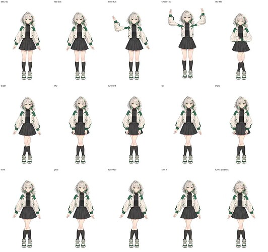

基于https://www.nodeloc.com/t/topic/115186
所做
这是一个关于恩娜enna的Wiki：https://www.nodeloc.wiki/w/%E6%81%A9%E5%A8%9C%EF%BC%88NodeLoc%20%E5%A8%98%EF%BC%89
这是初步制作的live2D模型的预览

稍后会把模型文件发布
对了，感觉Enna酱的中文名好奇怪 不知道能不能改
比如说我自己随便翻译的：蒽雫?（因为实在是找不到en音的中文的对应啦）
还有哈基米4的：恩奈
好了，我找到更好的了，en可以不用化学用字了
可以叫enna为「𡟯雫」
发音：ēn nǎ
1. 𡟯
字典出处：
《康熙字典》【丑集下】【女字部】引宋代韵书《集韵》：“烏痕切，音恩。女字。”
另有字典记音为 bì（但作为“女+恩”形声字，正统古韵切音就是“恩”）。
字面意思：
女子人名用字 。
古人造这个字就是专门用来给女孩起名字的！字形由“女”与“恩”组成，既有知恩、承恩的意蕴，又自带女子的温婉灵秀。
2. 雫
字典出处：
《康熙字典》【備考】【戌集】【雨部】引《龙龛手鉴》：“奴寡切”（按现代汉语拼音规整读作 nǎ 或 xiá）。
在日本属于非常经典的“和制汉字”（国字），训读作 しずく（shizuku）。
字面意思：
会意字，“雨”落在“下”方，本义就是“雨滴、水滴、水珠” 💧。
在日文与二次元文学里象征清澈、晶莹、纯净的露珠或微雨，也是动漫里极受欢迎的女孩人名常用字。
所以「𡟯雫」
𡟯寄托的是“知恩念情、温柔明理、集万千宠爱于一身”的美德与福气 。而“雫”在和风意境中是清澈晶莹的雨珠 。

原发于 NodeLoc 论坛：https://www.nodeloc.com/t/topic/115203
