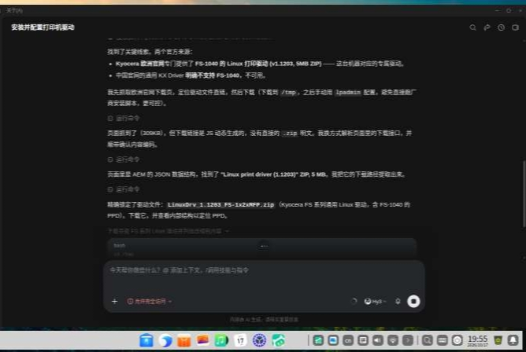
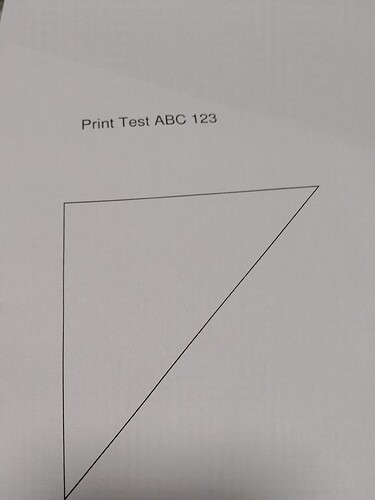
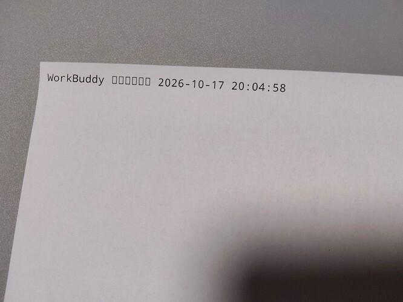

真是太激动了！！！

我来自己简述一下，就是我之前是换过一次Linux的，但是就是因为打印机驱动的问题又回Windows了

这个驱动当时我反反复复找好几次（几乎每次用Linux，都回去挑战一下，包括后续拿到nas/小主机，都会去再试一试，毕竟我这个记性可能有点差），但是很显然次次失败，要么就是驱动老了，要么就是不兼容，要么就是不管用，然后就放弃了。

这次借助ai（闲的没事干，就是去试试workbuddy，用这个的原因是，这个电脑太老了，CPU对opencode的命令集都不支持，然后又是刚刚装完系统，因为显卡也太老，所以说急着装驱动，搞代理或上中转站也不太现实，所以说codex和claude code也排除，故使用了workbuddy这玩意），就也是成功的拿下了！

以下是ai的总结，大家如果有需要可以参考：

```
## 安装 Kyocera FS-1040 打印机驱动（Deepin 20.9 x86_64）
- 设备：Kyocera FS-1040（USB，序列号 NSB5172012）。系统 Deepin 20.9，CUPS 已运行（lpadmin/cupsctl/lpstat 均在）。
- 系统自带 foomatic/gutenprint 无 Kyocera 驱动；`driverless` 不支持（老款 USB，无 IPP-over-USB）。
- 驱动来源：Kyocera 欧洲官网 FS-1040 专属 Linux 驱动 `LinuxDrv_1.1203_FS-1x2xMFP.zip`
  - 直链：https://www.kyoceradocumentsolutions.eu/content/dam/download-center-cf/eu/drivers/all/LinuxDrv_1_1203_FS_1x2xMFP_zip.download.zip
  - 注意：中国官网的通用 KX Driver 明确不支持 FS-1040，勿用。

- 安装要点：
  - PPD 在包内 `Linux/64bit/Global/English.tar.gz` → `Kyocera_FS-1040GDI.ppd`；配套过滤器 `rastertokpsl`。
  - **关键坑**：过滤器必须放 `/usr/lib/cups/filter/rastertokpsl` 且由 root 拥有，否则 CUPS 报 `insecure-filter` 并拒绝执行（普通用户/非标准目录都不行，作业会卡死）。
  - 落盘需 root：本环境 `pkexec` 免密可用 → `pkexec bash -c 'cp .../rastertokpsl /usr/lib/cups/filter/; chown root:lp; chmod 755'`。
  - 添加打印机：`lpadmin -p FS-1040 -E -v "usb://Kyocera/FS-1040?serial=NSB5172012" -P <ppd>`（用户在 lpadmin 组，无需 sudo）。
  - 设默认：`lpoptions -d FS-1040`。
- 验证：测试打印 3 次作业全部 completed；中文文本作业也能正常提交完成。
```

附打印测试和过程时截图：







原发于 NodeLoc 论坛：https://www.nodeloc.com/t/topic/114339
