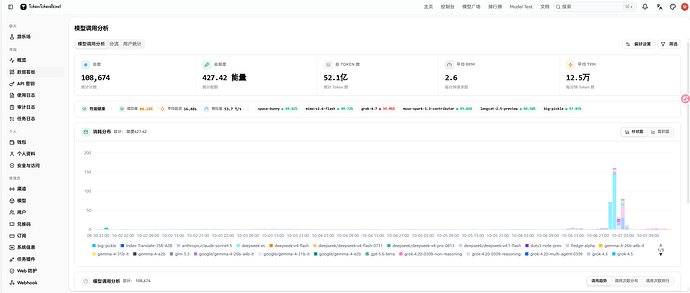
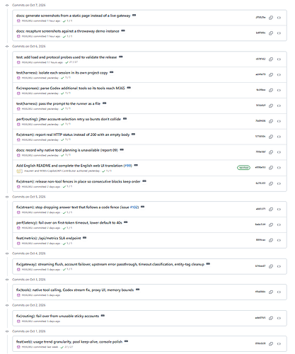

首先是 **[TokenTokenBond](https://api.tokentoken.bond/)**

从只有一个服务器开始

到现在除去grok外，较为稳定给大家提供了共计 **52.1亿**token的api服务！

（而且还进行了一次狂欢，[[ ✨TokenTokenBond✨]限时免费领取您的疯狂（限时 5H） 套餐。有效期 5 小时 无限额度，无限并发！目前进行了性能优化与重构项目，欢迎测试！](https://www.nodeloc.com/t/topic/112695)  ，你看那个高高的柱子就是了）

二 ，M365-Copilot2API

其次是[GitHub - HEXUXIU/M365-Copilot2API: Microsoft 365 Copilot → OpenAI / Anthropic 兼容 API 网关。 · GitHub](https://github.com/HEXUXIU/M365-Copilot2API/)

在这个假期期间

完成了数次提交，似乎是从v0.7.0一路更新到目前的 **[v0.7.3](https://github.com/HEXUXIU/M365-Copilot2API/releases/tag/v0.7.3)**

三,模型训练与数据归档

最后就是完成了

[说开源就开源！NodeLoc Archiver！主题数近五万个，帖子近八十万条！ - 科技与创作 / 编程开发 - NodeLoc](https://www.nodeloc.com/t/topic/112513)

[自训练的Prochlo-190M-SFT发布！现在模型可以基础的聊天了！ - 科技与创作 / MLOps & 推理 - NodeLoc](/posts/prochlo-190m-sft/)

一个对于nodeloc的数据归档与清洗，另外一个就是一个独立的英语小模型！（因为都是和huggingface平台有关系，我就发一起了，但是实际上这俩没有一点直接关系，模型是英语模型哈）

还有搞了个,com

[拿下了人生的第一个 .com 域名!](https://www.nodeloc.com/t/topic/112614)

这个下周继续吧

还算比较充实吧 

原发于 NodeLoc 论坛：https://www.nodeloc.com/t/topic/112797
